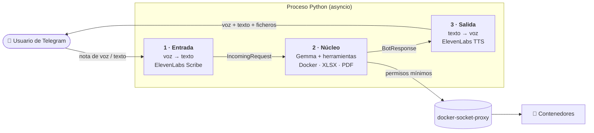

<div align="center">

# 🎙️ DockerOps · bot de Telegram por voz

**Háblale a tu servidor.** Un bot de Telegram al que le mandas una nota de voz y que gestiona tus contenedores Docker, te responde con su propia voz y te prepara informes en Excel, PDF y gráficas.

[](https://github.com/angelmq152/hacktoberfest/actions/workflows/ci.yml)


</div>

---

## ✨ Qué hace

| Le dices… | El bot… |
|---|---|
| 🎙️ «¿Cómo están mis contenedores?» | Te cuenta por voz cuántos hay en marcha y cuáles están caídos, y te manda una tabla con el detalle. |
| 🎙️ «¿Por qué se ha caído el worker?» | Lee los logs y te resume el problema. |
| 🎙️ «Reinícialo» | Te pide confirmación con un botón y, cuando la das, lo reinicia. |
| 🎙️ «Mándame un informe del consumo» | Genera un **Excel**, un **PDF** y una **gráfica** con CPU, RAM, uptime y reinicios. |

También entiende texto escrito y tolera erratas de la transcripción (si dices «graffana», sabe que hablas de `grafana`).

## 🧩 Cómo funciona



Los tres módulos se comunican **solo** a través de las dataclasses de [`shared/contracts.py`](shared/contracts.py), así que cada parte se puede desarrollar y probar por separado.

### Herramientas del núcleo

| Herramienta | Qué hace | ¿Pide confirmación? |
|---|---|:---:|
| `list_containers` | Lista los contenedores gestionados | — |
| `container_status` | Estado, uptime y reinicios de un contenedor | — |
| `container_logs` | Últimas líneas del log (máx. 500) | — |
| `container_stats` | Consumo de CPU y RAM | — |
| `restart_container` · `stop_container` · `start_container` | Acciones sobre un contenedor | ✅ |
| `make_excel` · `make_pdf` · `make_chart` | Informes a medida | — |
| `docker_report` | Foto completa: Excel + PDF con gráfica | — |

## 🔒 Seguridad

- **Nunca** se monta `/var/run/docker.sock` en el bot. Todo pasa por [`docker-socket-proxy`](https://github.com/Tecnativa/docker-socket-proxy), con `EXEC`, `IMAGES`, `VOLUMES`, `NETWORKS` y `BUILD` bloqueados.
- Solo se gestionan los contenedores que llevan la label `hackbot.manage=true`.
- Las acciones peligrosas se quedan pendientes 60 s y solo se ejecutan si **el mismo usuario** pulsa «Confirmar».
- Solo responde a los IDs de Telegram de `ALLOWED_USER_IDS`.
- Los logs se truncan y se tratan como datos, no como instrucciones (para evitar prompt injection).
- El token de Telegram no aparece en los logs.

## 🚀 Puesta en marcha

**Requisitos:** Python 3.12, `ffmpeg` en el PATH y acceso a un Docker (idealmente detrás de `docker-socket-proxy`).

```bash
git clone https://github.com/angelmq152/hacktoberfest.git
cd hacktoberfest
python -m venv .venv && source .venv/bin/activate
pip install -r requirements.txt

cp .env.example .env    # y rellena los valores
python main.py
```

### Variables de entorno

| Variable | Para qué sirve |
|---|---|
| `TELEGRAM_TOKEN` | Token del bot (de [@BotFather](https://t.me/BotFather)) |
| `ALLOWED_USER_IDS` | IDs de Telegram autorizados, separados por comas |
| `ELEVENLABS_API_KEY` · `ELEVENLABS_VOICE_ID` · `ELEVENLABS_TTS_MODEL` | Voz (STT y TTS). Sin clave, el bot responde solo con texto |
| `GEMMA_API_KEY` · `GEMMA_BASE_URL` · `GEMMA_MODEL` | El LLM. Si `GEMMA_BASE_URL` está vacío, se usa Google AI Studio |
| `DOCKER_HOST` | Dirección del socket proxy (`tcp://socket-proxy:2375`) |
| `MANAGED_LABEL` | Label que marca los contenedores gestionables |
| `OUT_DIR` | Carpeta donde se guardan los informes generados |

### 🧪 Entorno de demo

En [`demo/`](demo/README.md) hay un stack de contenedores de prueba: grafana, redis, postgres, nginx, un `worker` que falla a propósito, otro con un healthcheck que no pasa, etc. Así hay algo que listar, reiniciar y diagnosticar:

```bash
cp demo/.env.example demo/.env
docker compose -f demo/compose.yaml up -d
```

## 🛠️ Desarrollo

```bash
pip install -r requirements-dev.txt
pre-commit install      # ruff + pytest antes de cada commit
pytest -q
```

La suite de tests (pytest, sin red) y `ruff` se ejecutan automáticamente en cada PR mediante [GitHub Actions](.github/workflows/ci.yml).

```
├── input/     Parte 1 · Entrada  (voz → texto)
├── core/      Parte 2 · Núcleo   (Gemma + herramientas)
│   └── tools/   docker_tools.py, reports.py
├── output/    Parte 3 · Salida   (texto → voz, envío a Telegram)
├── shared/    Contratos y configuración comunes
├── demo/      Stack de contenedores de prueba
├── tests/     Tests unitarios
└── main.py    Une las tres partes
```

## 👥 Equipo

| Parte | Persona | Carpeta |
|---|---|---|
| 1 · Entrada | **Alex** | [`input/`](input/) |
| 2 · Núcleo | **Angel** | [`core/`](core/) |
| 3 · Salida | **Pedro** | [`output/`](output/README.md) |

## 🤝 Cómo contribuir

1. Lee el [plan del proyecto](docs/PLAN.md). Si eres un agente de IA, lee también [AGENTS.md](AGENTS.md).
2. Crea una rama: `git checkout -b mi-cambio`.
3. Comprueba que `ruff check .` y `pytest -q` pasan.
4. Abre un Pull Request pequeño contra `main`.

<div align="center">
<sub>Hecho con ☕ durante el Hacktoberfest 2026.</sub>
</div>
